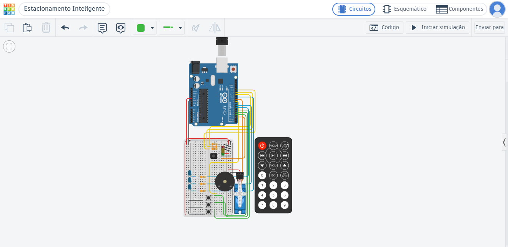
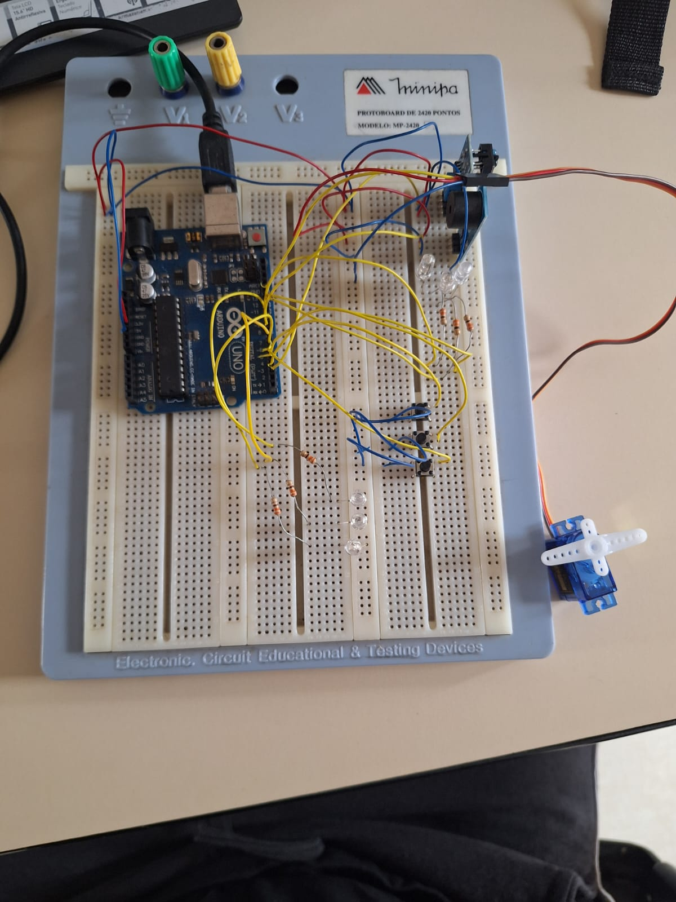

# Smart Parking — Sistema de Monitoramento e Automação de Estacionamento

Protótipo de automação e telemetria para estacionamentos que integra **Arduino Uno**, **Python/Flask**, **Dashboard Web** e automação em nuvem via **Make** e **Google Sheets**. O sistema permite monitorar em tempo real a disponibilidade de 3 vagas, o estado da cancela de acesso e o histórico operacional de eventos.

---

## Arquitetura do Sistema

O projeto opera em dois fluxos principais:

* **Fluxo local de monitoramento e controle:**
  `Arduino Uno → Python/Flask → Dashboard Web`
* **Fluxo externo de registro e integração em nuvem:**
  `Python/Flask → Webhook Make → Google Sheets`

### Como funciona o envio de eventos para o Make

1. Sempre que uma mudança de estado ocorre (ocupação/liberação de vaga, movimentação da cancela ou detecção de veículo), a função `registrar_evento()` grava o registro no histórico local do Flask (`deque` em memória).
2. Caso a variável de ambiente `MAKE_WEBHOOK_URL` esteja configurada, o evento é inserido em uma fila não bloqueante (`queue.Queue(maxsize=200)`).
3. Uma *thread* dedicada (`processar_fila_make`) consome essa fila em segundo plano e envia os dados via requisição HTTP `POST` (codificação UTF-8) para o webhook do Make, sem travar a API Flask nem a leitura serial.
4. **Limitação técnica conhecida:** A fila atual é mantida exclusivamente em memória RAM, não possuindo persistência em disco nem mecanismo de reenvio automático em caso de queda de rede ou falha HTTP.

---

## Tecnologias Utilizadas

* **Backend e Integração:** Python, Flask, PySerial
* **Frontend:** HTML, CSS e JavaScript
* **Hardware e Embarcados:** Arduino Uno (sensor reflexivo infravermelho TCRT5000, micro servo motor MG90S, botões táteis, LEDs e buzzer)
* **Automação e Persistência Externa:** Make (Custom Webhook) e Google Sheets

---

## Status de desenvolvimento e validação

### Implementado e testado

* Dashboard web responsivo e simulador interativo (`frontend/templates/index.html`).
* Backend em Python com servidor Flask e API REST (`backend/leitura_arduino.py`).
* Registro estruturado de eventos em memória no backend.
* Comunicação assíncrona `Python → Webhook Make` via fila e *thread* separada.
* Automação `Make → Google Sheets` recebendo e gravando os payloads enviados pelo backend.
* Registro automático de eventos de ocupação de vaga, chegada de veículo e estado da cancela gerados pelo simulador web.
* Codificação UTF-8 validada nos eventos testados.

### Em fase de testes / não validado

* Comunicação bidirecional física entre Arduino Uno e Python via porta serial.
* Funcionamento contínuo e calibrado do micro servo MG90S e do sensor TCRT5000 na bancada.
* Validação integral do circuito físico montado em protoboard.
* Operação do sistema completo com hardware físico conectado ao backend.

### Melhorias futuras planejadas

* **Sincronização inicial na conexão serial:** Atualmente, o backend aguarda 2 segundos após abrir a porta serial e executa `reset_input_buffer()`, o que pode descartar mensagens enviadas pelo Arduino durante o *boot* (como `SYSTEM,STARTED` e os estados iniciais das vagas). Como melhoria futura para os testes físicos, será implementada a solicitação automática de `CMD,STATUS` logo após a conexão serial para sincronizar o estado inicial.

---

## Estrutura do Repositório

```text
SmartParking/
├── backend/
│   ├── leitura_arduino.py
│   └── requirements.txt
├── docs/
│   ├── arquitetura/
│   │   └── arquitetura.md
│   ├── circuito-fisico/
│   │   └── circuito-fisico.jpeg
│   ├── especificacoes-tecnicas/
│   │   └── especificacoes.md
│   └── simulacao-tinkercad/
│       └── Tinercad-smart.png
├── firmware/
│   └── estacionamento_inteligente/
│       └── estacionamento_inteligente.ino
├── frontend/
│   └── templates/
│       └── index.html
├── .gitignore
└── README.md
```

---

## Documentação e Evidências Visuais

### Documentação Técnica

* [Arquitetura do Sistema](docs/arquitetura/arquitetura.md)
* [Especificações Técnicas e Protocolo Serial](docs/especificacoes-tecnicas/especificacoes.md)
* [Código-fonte do Firmware Arduino](firmware/estacionamento_inteligente/estacionamento_inteligente.ino)

### Evidências do Circuito

| Simulação no Tinkercad | Protótipo Físico em Protoboard |
| :---: | :---: |
|  |  |
| [Abrir imagem original](docs/simulacao-tinkercad/Tinercad-smart.png) | [Abrir imagem original](docs/circuito-fisico/circuito-fisico.jpeg) |

---

## Instalação e Execução

### 1. Clonar o repositório

```bash
git clone [https://github.com/C4fesin/SmartParking.git](https://github.com/C4fesin/SmartParking.git)
cd SmartParking
```

### 2. Criar e ativar o ambiente virtual Python

```bash
python -m venv .venv
```

* **Windows (PowerShell):**

```powershell
.venv\Scripts\Activate.ps1
```

* **Linux / macOS:**

```bash
source .venv/bin/activate
```

### 3. Instalar as dependências

```bash
pip install -r backend/requirements.txt
```

### 4. Executar o sistema (modo local, sem Make)

* **Windows (PowerShell):**

```powershell
py backend\leitura_arduino.py
```

* **Linux / macOS:**

```bash
python backend/leitura_arduino.py
```

Após iniciar, abra no navegador: `http://127.0.0.1:5000`

---

## Configuração da Integração com Make

A URL do webhook não é armazenada no código-fonte por segurança. Para ativar o envio automático de eventos ao Make e ao Google Sheets, defina a variável de ambiente `MAKE_WEBHOOK_URL` na sessão do terminal antes de iniciar o servidor:

* **Windows (PowerShell):**

```powershell
$env:MAKE_WEBHOOK_URL = "SUA_URL_PRIVADA_DO_WEBHOOK"
py backend\leitura_arduino.py
```

* **Linux / macOS:**

```bash
export MAKE_WEBHOOK_URL="SUA_URL_PRIVADA_DO_WEBHOOK"
python backend/leitura_arduino.py
```

---

## Endpoints da API REST

| Rota | Método | Status | Descrição |
| :--- | :---: | :---: | :--- |
| `/` | `GET` | Testado | Renderiza o dashboard web (`frontend/templates/index.html`) |
| `/api/status` | `GET` | Testado | Retorna o estado atual do sistema, cancela e contagem de vagas |
| `/api/events` | `GET` | Testado | Retorna os últimos 100 eventos registrados em memória |
| `/api/simulate` | `POST` | Testado | Altera o estado internamente no backend para testar o dashboard e o Make (não envia comandos ao Arduino) |
| `/api/command` | `POST` | Pendente | Envia comandos seriais ao Arduino físico (`CMD,OPEN`, `CMD,CLOSE`, `CMD,STATUS`) — aguardando validação com hardware |
| `/health` | `GET` | Testado | Informa se o servidor Flask está online e o status da conexão serial |